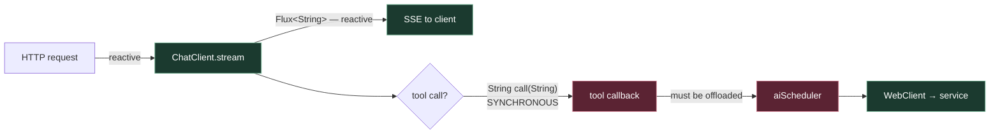

# 00 — Context & Verified Facts

## Context

`/Users/shoaib.doulatabad/stuff/spring/train-booking-ai` is currently an empty Spring Boot starter — `TrainBookingAiApplication.java`, an empty `application.properties`, one test, and a `pom.xml` (Boot 4.1.1, Java 25, Spring Cloud 2025.1.3, groupId `org.presight.ai`). Not yet a git repo.

The goal is an **AI-driven train booking system** built as reactive microservices, where a conversational assistant backed by a **local** Ollama model can search trains, hold seats and complete bookings by calling real services — never by inventing data. AI is local-only for now (no cloud LLM). Clients are React web + mobile.

## Verified version matrix

Checked directly against Maven Central repository metadata and the local machine — not recalled, not taken from search snippets.

| Component | Version | How verified |
|---|---|---|
| Spring Boot | 4.1.1 | latest 4.x in `maven-metadata.xml` ✓ |
| Spring Cloud | 2025.1.3 | POM resolves HTTP 200 ✓ |
| **Spring AI BOM** | **2.0.1** | **newest GA on Central; POM HTTP 200 ✓** |
| `spring-ai-starter-model-ollama` | 2.0.1 | HTTP 200 ✓ |
| `spring-ai-starter-vector-store-pgvector` | 2.0.1 | HTTP 200 ✓ |
| Keycloak | 26.7.x | current stable |
| Kong Gateway | 3.16.x (patched) | CVE-2026-14916 — see [05-security.md](05-security.md) |
| Ollama runtime | 0.34.2 | ≥ 0.20.0 required ✓ |
| Java | GraalVM CE 25.0.2 | ✓ |
| Docker / Compose | 29.4.0 / v5.1.2 | ✓ |
| Node | v25.6.1 | ✓ |
| Machine | 36 GB RAM, 12 CPU | ✓ |

> **Do not use Spring AI 1.x.** The 1.1.x line targets Boot 3.5.x; the 2.0.x line is the Boot 4 / Spring Framework 7 line. Confirmed from cached autoconfigure POMs: `autoconfig-ollama 1.1.0 → spring-boot-starter 3.5.7` vs `2.0.x → spring-boot-starter 4.1.x`.
>
> Note `search.maven.org`'s Solr index is **stale** and still reports 1.0.0 as newest. `repo1.maven.org/.../maven-metadata.xml` is authoritative. Use **2.0.1 GA** — no milestone repository needed.

## Local models

| Model | Facts | Consequence |
|---|---|---|
| `gemma4:latest` | 8B, Q4_K_M, ctx **131072**, embed 2560; caps: completion, **tools**, thinking, vision, audio | Official Ollama library model. **Tool calling viable — the hinge of the whole design.** |
| `mxbai-embed-large` | bert, 334M, ctx **512**, dim **1024** | pgvector column is `vector(1024)`. Chunks must stay well under 512 tokens or they are **silently truncated**. |

Two hard numbers fall out, neither of them guesses: the vector column width, and the RAG chunk ceiling.

## The two constraints that shape the architecture

### 1. `PgVectorStore` is JDBC-only — confirmed, not assumed

The 2.0.1 starter POM declares `spring-boot-starter-jdbc` as a **direct dependency**. There is no R2DBC vector store in Spring AI. So `ai-assistant-service` — and *only* that service — runs **two Postgres pools**:

| Pool | Driver | Purpose | Sizing |
|---|---|---|---|
| R2DBC | `r2dbc-postgresql` | ordinary reactive reads/writes | max 10 |
| JDBC (HikariCP) | `postgresql` | pgvector search + embedding writes | **max 8** |

Hikari at 8 is deliberate: ≥ the vector scheduler's concurrency cap, so retrieval never queues on connection acquisition, yet small enough that several services on one box don't exhaust `max_connections`.

*Escape hatch if dual pools prove painful:* extract RAG into a small non-reactive `rag-service` (plain MVC on Java 25 virtual threads) behind HTTP. Keep it in the back pocket; don't build it on day one.

### 2. Spring AI tool callbacks are synchronous — verified from bytecode

```
public interface org.springframework.ai.tool.ToolCallback {
  public abstract java.lang.String call(java.lang.String);      // no Mono/Flux overload
  public default java.lang.String call(java.lang.String, ToolContext);
}

ChatClient.StreamResponseSpec.content() -> reactor.core.publisher.Flux<String>
StreamingChatModel.stream(Prompt)       -> Flux<ChatResponse>
```

Streaming *is* genuinely reactive; tool execution returns a bare `String` on the calling thread ([spring-ai#4434](https://github.com/spring-projects/spring-ai/issues/4434)).

**The blocking boundary is exactly one seam: the tool callback.** That precision is useful — it tells us exactly where to put the offload.



> **Accept this consciously.** The booking / catalog / inventory path is genuinely reactive end-to-end. **The AI path is blocking-with-offload.** That is a property of Spring AI today, not a design flaw to engineer around. Isolate it ([06-resilience.md](06-resilience.md)) rather than pretend it away — an unacknowledged blocking leak in a reactive system is worse than a frankly blocking one.

**If Spring AI later ships reactive tool callbacks, the offload becomes a one-line deletion** rather than a refactor. Design for that day: wrap Spring AI behind our own `ChatOrchestrator` / `TrainToolRegistry` interfaces so a breaking change touches one package, not six.

## Standing risk

Spring AI 2.0.1 is a recent GA on a young major line. **Treat it as the least stable dependency in the stack** and isolate it accordingly.