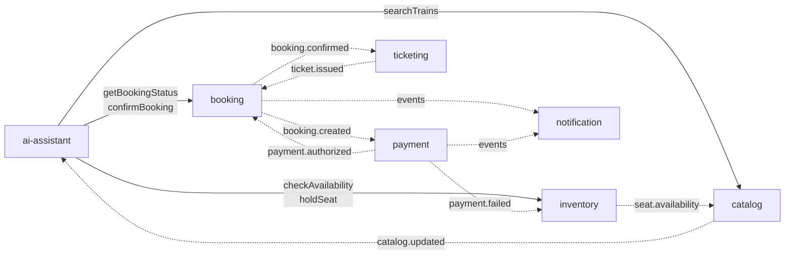

# 01 — Service Decomposition

Eight services. Kong and Keycloak are infrastructure you configure, not services you write.

| # | Service | Responsibility (bounded context) | Datastore it owns | Reactive? |
|---|---|---|---|---|
| 1 | `catalog-service` | Stations, routes, schedules, fare rules. Read-heavy, near-static. | MongoDB + Redis | Fully reactive |
| 2 | `inventory-service` | Seat/berth inventory, holds, allocation. **The hard one.** | Postgres (R2DBC) + Redis | Fully reactive |
| 3 | `booking-service` | Booking aggregate, saga state, PNR lifecycle, outbox | Postgres (R2DBC) | Fully reactive |
| 4 | `payment-service` | Payment intents, capture, refunds, compensation | Postgres (R2DBC) | Fully reactive |
| 5 | `ticketing-service` | Ticket issuance, QR/barcode, PDF | Postgres + object store | Fully reactive |
| 6 | `notification-service` | Email/SMS/push fan-out | MongoDB | Reactive + Kafka consumer threads |
| 7 | `user-profile-service` | Profile, preferences, travellers, loyalty | Postgres (R2DBC) | Fully reactive |
| 8 | `ai-assistant-service` | NL chat, RAG, tool calling | Mongo (memory) + Postgres/pgvector (JDBC) | **Blocking-with-offload** |

## Why each store (database-per-service)

The requirement was "multiple DBs for different use cases." Polyglot persistence must be *justified per service*, not decorative.

- **Postgres + R2DBC** — `inventory`, `booking`, `payment`, `ticketing`, `user-profile`. These need ACID, real constraints, and row-level locking. Seat inventory without transactional integrity is a double-booking generator. Non-negotiable.
- **MongoDB** — `catalog` and `notification`. Catalog documents are denormalised, deeply nested (route → legs → stops → fare classes), read-dominated, schema-evolving. Notifications are append-mostly semi-structured payloads. `ReactiveMongoRepository` is genuinely reactive end to end.
- **Redis** — cache, distributed locks, rate limiting, seat-hold TTLs. Lettuce is reactive and non-blocking.
- **Postgres + pgvector** — RAG embeddings, **but via JDBC** (see [00-overview.md](00-overview.md)).

Separate logical DBs and credentials, **no cross-service SQL**. Locally, one Postgres container with N databases (`booking`, `inventory`, `payment`, `ticketing`, `profile`, `keycloak`, `vectordb`) is an acceptable economy.

### Deliberate exclusion

`catalog-service` does **not** own fare *calculation*. Fare rules live in catalog as documents; the authoritative computed price comes from `booking-service` at quote time. Letting two services both compute prices is how you get a UI that quotes one number and charges another.

### Why `inventory` is split from `booking`

The decomposition call that matters most. They have fundamentally different load profiles:

- `inventory` is **write-hot and heavily contended** — many concurrent attempts on one seat map. It needs tiny transactions and aggressive locking.
- `booking` is **long-lived and saga-coordinating** — one row, alive for minutes across a distributed flow.

Merging them drags saga-length transactions into the seat-contention lock domain.

## APIs and events

| Service | Key APIs | Produces | Consumes |
|---|---|---|---|
| catalog | `GET /stations`, `GET /routes/search`, `GET /fares/rules` | `catalog.updated.v1` | — |
| inventory | `POST /holds`, `DELETE /holds/{id}`, `POST /holds/{id}/commit`, `GET /availability` | `seat.held.v1`, `seat.released.v1`, `seat.committed.v1` | `booking.cancelled.v1`, `payment.failed.v1` |
| booking | `POST /bookings`, `GET /bookings/{id}`, `POST /bookings/{id}/cancel` | `booking.created.v1`, `booking.confirmed.v1`, `booking.cancelled.v1` | `payment.*`, `ticket.issued.v1`, `seat.*` |
| payment | `POST /payments` (idempotent), `POST /payments/{id}/refund` | `payment.authorized.v1`, `payment.failed.v1`, `payment.refunded.v1` | `booking.created.v1` |
| ticketing | `GET /tickets/{pnr}` | `ticket.issued.v1`, `ticket.voided.v1` | `booking.confirmed.v1`, `booking.cancelled.v1` |
| notification | (internal, event-driven) | `notification.sent.v1` | `booking.*`, `payment.*`, `ticket.*` |
| user-profile | `GET/PUT /me`, `GET /me/travellers` | `profile.updated.v1` | — |
| ai-assistant | `POST /chat` (SSE), `WS /chat/stream` | `ai.conversation.v1`, `ai.toolcall.v1` | `catalog.updated.v1` (RAG reindex) |

## Service interaction

Solid arrows are synchronous HTTP (tool calls, JWT relayed). Dashed arrows are Kafka events.