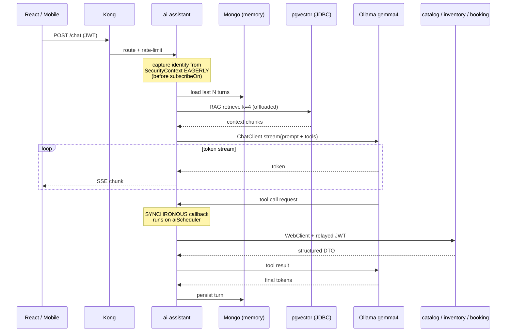
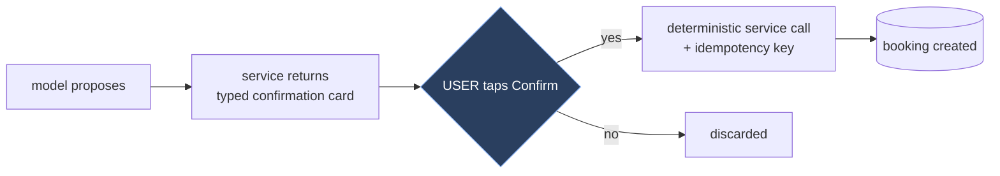

# 02 — The AI Layer

The differentiator. Also the only part of the system that is not fully reactive — see [00-overview.md](00-overview.md).

## Chat flow



Stream over **SSE** (`Flux<ServerSentEvent<…>>`), not WebSocket: unidirectional, proxy-friendly, auto-reconnects, no upgrade config in Kong. Reserve WebSocket for the live seat map, which is genuinely bidirectional.

## Tools

Thin façades over real service calls. `@Tool` on a Spring bean, registered via `ChatClient.builder().defaultTools(...)`.

| Tool | Backing call | Mutating |
|---|---|---|
| `searchTrains(from,to,date,passengers,class)` | catalog | No |
| `checkAvailability(trainId,date,class)` | inventory | No |
| `getBookingStatus(bookingRef)` | booking | No |
| `holdSeat(trainId,date,seats,passengers)` | inventory | **Yes — reversible (TTL)** |
| `confirmBooking(holdId,paymentRef,idempotencyKey)` | booking | **Yes — money** |
| `cancelBooking(bookingRef,reason,idempotencyKey)` | booking | **Yes — irreversible** |

**Tools return structured DTOs, never prose.** The model narrates; it never authors data.

## Guardrails — the LLM must not be able to invent a booking

Architectural invariants, not prompt text. Prompts are advisory; these are enforcement.



1. **Two-phase confirmation.** `confirmBooking` requires a server-issued `holdId` (UUIDv7, validated server-side) from a prior real `holdSeat` call in the same conversation. The model cannot fabricate one. *The irreversible action is structurally unreachable without a preceding reversible one* — this carries the real weight.
2. **Human-in-the-loop on irreversible tools.** `confirmBooking`/`cancelBooking` do not fire on the model's say-so. The tool returns a `ConfirmationRequired` envelope; React renders an explicit confirm button; the client then calls `POST /bookings` directly. **The LLM proposes; the user disposes.**
3. **Server-derived idempotency keys** — `hash(userId+holdId+op)`, never model-supplied. A hallucinated duplicate call yields exactly one booking.
4. **Prices/availability are never model-generated.** A post-response validator checks currency figures in the output against the turn's tool results; emit `ai.hallucinated_price` on mismatch. (Mitigation, not proof — hence rule 1.)
5. **Tool budget:** max 5 calls/turn, max 2 mutating. Enforced in orchestration, not the prompt.

**Rationale:** an 8B quantised model *will* occasionally hallucinate a plausible-looking train, fare, or PNR. Hallucinating text is recoverable. Hallucinating a charge is not. The deterministic service is the sole source of truth; the LLM is a routing and phrasing layer over it.

## Identity propagation — the LLM cannot exceed the caller's authority

**Rule: the model never supplies identity; it is bound out-of-band.**

1. Kong forwards the JWT; Spring Security validates it into a `JwtAuthenticationToken`.
2. **Before** the chat pipeline starts, extract `sub` + roles from the reactive `SecurityContext` and stash them in Spring AI's **`ToolContext`**.
3. Tool callbacks read identity **from `ToolContext`, never from model arguments**.
4. Downstream calls attach the original JWT; each service re-authorises independently.
5. Tool results are scope-filtered before returning to the model.

> ### ⚠ The bug waiting to happen
>
> Reactor's `SecurityContext` propagation **does not automatically cross the `subscribeOn` boundary** into `aiScheduler`. **Capture identity eagerly, before the offload** — never lazily inside the tool callback. If a tool reads an empty `SecurityContext` and any code path treats that as "no restriction," it is an auth bypass.
>
> Covered by the Phase 3 negative test: user A must not reach user B's booking through chat.

**`userId` is not a tool parameter.** It is absent from the JSON schema the model sees, so the model cannot even express "book for another user." Were it a parameter, "show me booking for user 12345" would become an IDOR with the model as confused deputy.

The model supplies **intent**; the security context supplies **identity**. Those paths never cross.

**Assume the model will be prompt-injected** — e.g. via a poisoned station description in the RAG corpus — and make it harmless. Scope-filtering tool results means even a successful injection returns only the caller's rows.

## Conversation memory (Mongo)

```
conversations: { _id, userId, title, createdAt, updatedAt, status }
messages:      { _id, conversationId, seq, role, content, toolCalls[],
                 toolResults[], tokensIn, tokensOut, modelVersion, latencyMs }
```

Indexes `{conversationId, seq}`, `{userId, updatedAt desc}`; TTL on guest conversations (30d).

**Window to ~10–20 turns + rolling summary** despite the 131k context. An 8B Q4 model's attention degrades well before its advertised limit, and prompt size is latency here. Prefer a hand-rolled repository behind your own interface over Spring AI's `ChatMemoryRepository`, to limit coupling to a young API.

## RAG

**Chunking is the binding constraint.** `mxbai-embed-large` truncates past 512 tokens *silently* — you get an embedding of the first 512 tokens and a store that quietly returns wrong results. This is the worst failure mode: retrieval degrades without ever erroring.

- Chunk to **≤ 380 tokens**, 50–60 token overlap (headroom for wordpiece variance vs. your splitter's estimate).
- **Ingestion-time assertion: fail the pipeline on any chunk > 500 tokens.** Do not discover this in production.
- Prefix queries with `Represent this sentence for searching relevant passages:` — mxbai is trained asymmetrically and retrieval quality drops measurably without it.
- Schema `vector(1024)`, HNSW (`m=16, ef_construction=64`), cosine distance.
- Metadata `jsonb` `{docType, stationCode, routeId, validFrom, validTo, lang}` with pre-filtering on docType **and date validity — serving an expired fare rule is a correctness bug, not a relevance one.**
- **All vector calls offloaded:** `Mono.fromCallable(() -> vectorStore.similaritySearch(req)).subscribeOn(vectorScheduler)` — never called inline.

Corpus: station names/aliases, route topology, fare rules, baggage/pet/accessibility policy, refund/cancellation policy, FAQs. Reindexed on `catalog.updated.v1`.

## System prompt

Short and concrete — small models follow terse instructions far better than long policy essays.

```
You are the booking assistant for <Rail>. Today is {date}. User: {firstName}.
Rules:
- Use tools for ALL facts about trains, seats, prices, bookings. Never guess.
- Never state a price or availability that did not come from a tool result.
- To book: searchTrains → checkAvailability → holdSeat → summary → confirmBooking.
- Never call confirmBooking/cancelBooking without an explicit user "yes".
- If a tool fails, say so plainly. Do not invent a result.
- Reply in the user's language. Be brief.
Reference material (may be empty): {rag_context}
```

`temperature=0.2` for tool-calling turns — the model ships with **1.0**, far too high for reliable structured output. Up to 0.6 for pure chat. Disable `thinking` on latency-sensitive turns; it adds significant time-to-first-token.

## Fallback when Ollama is down

It will be — it's a laptop.

| Tier | Condition | Behaviour |
|---|---|---|
| 1 | Healthy | Full conversational streaming |
| 2 | p99 > 20s | Drop RAG + thinking, window to 4 turns |
| 3 | Circuit open | **Deterministic intent parse** — regex "London to Paris tomorrow" → `searchTrains`, render structured result cards, no prose |
| 4 | Total failure | Banner + classic form-based booking flow |
| — | Timeout mid-stream | Emit partial + explicit error event — **never a silent truncation** |

> **Booking must never depend on the LLM being up.** The AI is an alternative front door to a system that works without it. That is also what makes aggressive circuit-breaking safe, and it is what makes the feature shippable.