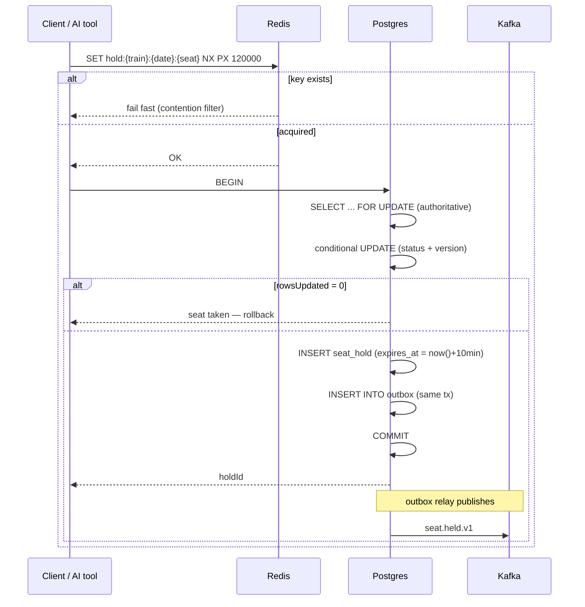
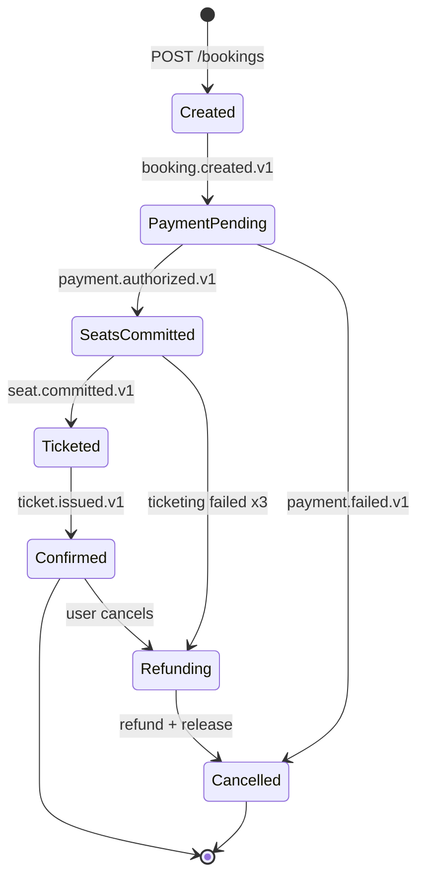

# 03 — Booking Consistency

The genuinely hard part. Seat inventory is where correctness is won or lost.

## Data model (Postgres, inventory-service)

```sql
seat_inventory(
  train_id, service_date, coach, seat_no,
  status,          -- AVAILABLE | HELD | BOOKED | BLOCKED
  hold_id, hold_expires_at,
  version bigint,  -- optimistic guard on top of the row lock
  PRIMARY KEY (train_id, service_date, coach, seat_no)
)

seat_hold(hold_id PK, user_id, train_id, service_date,
          seat_keys[], expires_at, status, created_at)
```

## Two-phase seat hold

**Redis alone is not sufficient** — a lock TTL expiring mid-transaction silently breaks mutual exclusion. Postgres is the source of truth; Redis is a fast-path contention filter. Conflating the two is the usual mistake.



The authoritative statement:

```sql
UPDATE seat_inventory
   SET status='HELD', hold_id=:h, hold_expires_at=now()+interval '10 min',
       version=version+1
 WHERE train_id=:t AND service_date=:d AND coach=:c AND seat_no=:s
   AND (status='AVAILABLE' OR (status='HELD' AND hold_expires_at < now()));
```

`rowsUpdated == 0` → seat taken.

> **This statement is correct with zero Redis involvement.** That is the property that makes the design safe, because distributed locks *do* fail — GC pause, network partition, TTL expiry mid-operation. Redis is an optimisation; Postgres is correctness.

The `version` column gives optimistic concurrency *on top of* the pessimistic lock — belt and braces on the one table where a lost update means a passenger without a seat.

Multi-seat holds sort seat keys in a canonical order before locking, to prevent deadlock.

### Hold expiry — two independent mechanisms

Each alone has a hole, so use both:

1. **Self-healing clause** — `hold_expires_at < now()` in the UPDATE means an expired hold is reclaimed on next contention, with no reaper needed.
2. **Postgres sweeper** (every 30s, `SKIP LOCKED`, batched) releases expired holds and emits `seat.hold.expired`. **This is the correctness guarantee** — slow but total.
3. **Redis TTL** as the fast path — latency optimisation only.

> **Do not rely on Redis keyspace notifications** for expiry. They are fire-and-forget and lossy if the consumer is down.

## Saga — choreography via Kafka



| Failure | Compensation |
|---|---|
| `payment.failed` | Release hold, `booking.cancelled`, notify |
| Hold expired pre-payment | Void/refund payment, cancel booking |
| Ticketing fails post-payment | Retry ×3 → refund + release + manual-queue alert |
| User cancels post-confirm | Refund per fare rules, release seats, void ticket |

Choreography suits this: 4 participants, mostly linear, no central bottleneck.

> **Caveat:** past ~5–6 participants, or once branching appears, choreographed sagas become undebuggable — the control flow exists only as an emergent property of the topic graph. **Carry an explicit `saga_state` column from day one** so migrating to orchestration is mechanical rather than a rewrite.

## Transactional outbox

Dual-writing to Postgres and Kafka is **not atomic**; a crash between them loses the event and strands the saga.

```sql
outbox(id uuid PK, aggregate_type, aggregate_id, event_type,
       payload jsonb, headers jsonb,
       created_at, published_at NULL, attempts int)
```

Business row + outbox row in **one R2DBC transaction**. A relay polls unpublished rows (`FOR UPDATE SKIP LOCKED`, batch 100, ~200ms), publishes to Kafka, marks published.

Start with the polling relay — simple, debuggable, no extra infra. Debezium CDC is the scale answer (no polling load, lower latency) but adds Kafka Connect; defer to Phase 7.

> **Delivery is at-least-once.** Every consumer must therefore be idempotent. State it plainly and design for it rather than discovering it.

## Idempotency

| Layer | Key | Store |
|---|---|---|
| Public API | client `Idempotency-Key` header | Redis 24h — **store the response**, so a retry returns the original 201, not a confusing 409 |
| AI tool calls | `hash(userId+holdId+op)` server-derived | Redis |
| Kafka consumers | `processed_events(topic, key, event_id, consumer_group)` unique | Postgres |
| Payments | `payment_intent(booking_id UNIQUE)` | Postgres |

**AI tool calls always pass an idempotency key.** Models sometimes re-emit tool calls; a retried or duplicated call must never produce two bookings. This is load-bearing, not defensive padding.