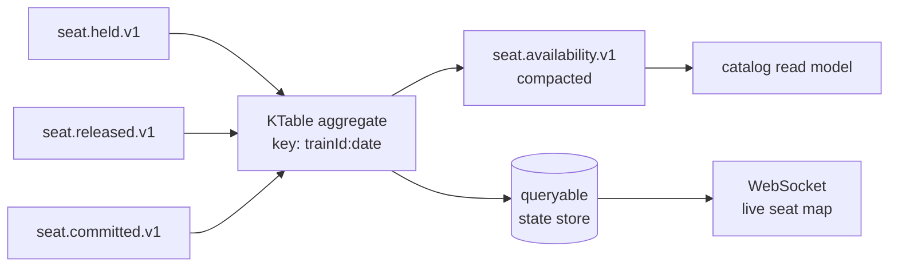

# 04 — Kafka Topology

## Client choice

> **Use `spring-kafka`, not `reactor-kafka`.**
>
> Reactor Kafka was **discontinued** (announced 2025-05-20, 1.3 final). Consequently `ReactiveKafkaProducerTemplate` / `ReactiveKafkaConsumerTemplate` and the Spring Cloud Stream Reactor Kafka binder are **deprecated and marked for removal**. Building on them now means building on a dead branch.

`spring-kafka`'s `@KafkaListener` container model is thread-pool based, not event-loop based. It does not corrupt the WebFlux layer, but **treat Kafka consumer threads as a separate blocking domain** and bridge into reactive pipelines deliberately.

## Topics

| Topic | Key | Partitions | Retention | Notes |
|---|---|---|---|---|
| `booking.created.v1` | bookingId | 12 | 7d | Saga entry |
| `booking.confirmed.v1` | bookingId | 12 | 30d | |
| `booking.cancelled.v1` | bookingId | 12 | 30d | |
| `payment.authorized.v1` | bookingId | 12 | 90d | Financial audit |
| `payment.failed.v1` | bookingId | 12 | 90d | |
| `payment.refunded.v1` | bookingId | 12 | 90d | |
| `seat.held.v1` | `trainId:date` | 24 | 1d | Hot key |
| `seat.released.v1` | `trainId:date` | 24 | 1d | |
| `seat.committed.v1` | `trainId:date` | 24 | 7d | |
| `seat.availability.v1` | `trainId:date` | 24 | **compact** | **KStreams output** |
| `catalog.updated.v1` | routeId | 6 | compact | Triggers RAG reindex |
| `ticket.issued.v1` / `.voided.v1` | bookingId | 12 | 90d | |
| `notification.requested.v1` | userId | 6 | 1d | |
| `ai.toolcall.v1` | conversationId | 6 | 7d | Analytics |
| `*.DLT` | original | 3 | 30d | Dead letter per consumer group |

### Partitioning rationale

- **Saga topics key on `bookingId`** — all events for one booking land on one partition and stay ordered.
- **Seat topics key on `trainId:serviceDate`** — the natural contention unit. This gives **per-train ordering without global ordering cost**, which is exactly what makes the Streams aggregation below correct. Double the partitions, because a popular train on a holiday is a hot key.

## Where Kafka Streams genuinely earns its place

Streams is a heavyweight dependency — state stores, rebalancing, changelog topics. Be selective.

| Use case | Verdict | Why |
|---|---|---|
| Seat-availability materialized view (KTable from held/released/committed → compacted topic + queryable store) | **Yes** | Real stateful aggregation. A plain consumer would need its own DB and would race. |
| Real-time occupancy analytics (5-min hopping windows per route/class) | **Yes** | Windowing is Streams' core strength; plain consumers do it badly. |
| Fraud / velocity signals (session-windowed holds-per-user, hold-to-book conversion → `risk.signal`) | **Yes** | Session windows are genuinely painful by hand. Catches seat-squatting. |
| Send an email on booking confirmed | **No** | Plain `@KafkaListener` |
| Reindex RAG on catalog update | **No** | Plain consumer |
| Saga steps, ticketing, outbox relay | **No** | Stateless per-message reactions; Streams is pure overhead |

## Kafka Streams is blocking — by design

Its own `StreamThread` pool, synchronous `process()`/`punctuate()`, blocking RocksDB state store. There is no reactive Kafka Streams and none is planned.

Treat it as an **isolated blocking subsystem**:
- Never call reactive code inside a `Processor` without blocking explicitly.
- Never run it on event-loop threads.
- Give it its own module (`streams/seat-availability-streams`) so the boundary is physical, not just conventional.