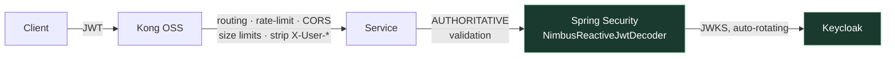

# 05 — Security

## Keycloak 26.7.x

Realm `train-booking`.

| Client | Type | Flow |
|---|---|---|
| `train-web` | public | Authorization Code + **PKCE**, no secret |
| `train-mobile` | public | Authorization Code + **PKCE**, app-claimed redirect |
| `train-services` | confidential | Client credentials (service-to-service) |
| `kong-gateway` | bearer-only | JWKS validation |

Roles: `ROLE_PASSENGER`, `ROLE_AGENT`, `ROLE_ADMIN`, `ROLE_SUPPORT`.
Scopes: `booking:read`, `booking:write`, `payment:write`, `profile:read`, `profile:write`, `ai:chat`.

Token claims: `sub`, `preferred_username`, `realm_access.roles`, `scope`, custom `loyalty_tier`. Access token **5 min**, refresh 30 min — short access tokens matter because pure JWT validation has **no revocation**.

> **Never the implicit flow. Never a client secret in a SPA or an APK.** Mobile stores refresh tokens in the OS keychain and prefers app-claimed HTTPS redirects over custom schemes, which can be hijacked by another installed app.

## Spring Security 7 — a deletion release

Config must reflect this, and copied-in older examples **will not compile**:

| Removed | Use instead |
|---|---|
| `.and()` chaining | Lambda DSL (mandatory) |
| `authorizeRequests()` | `authorizeExchange()` (reactive) |
| `AntPathRequestMatcher`, `MvcRequestMatcher` | `PathPatternRequestMatcher` |
| `AccessDecisionManager` | `AuthorizationManager` |
| `HttpSecurity#apply()` | `.with(...)` |

Use `@EnableWebFluxSecurity` + `SecurityWebFilterChain` + `NimbusReactiveJwtDecoder` throughout — all reactive, all non-blocking.

> **Do not use `keycloak-spring-security-adapter`.** Keycloak's own Spring adapters have been dead for years. Use plain Spring Security resource server against `issuer-uri` / `jwk-set-uri`.

A custom `ReactiveJwtAuthenticationConverter` maps `realm_access.roles` → `ROLE_*` authorities. Keycloak's claim layout is not Spring's default — this is a standard gotcha that silently yields zero authorities if skipped.

## Kong OSS — a correction worth taking seriously

> **The `openid-connect` plugin is Enterprise-only.** OSS Kong cannot do full OIDC — no code flow, no introspection, no auto-rotating JWKS.

The bundled OSS `jwt` plugin is consumer-centric:
- Requires Keycloak's realm public key pasted **manually per consumer**, keyed by `iss`
- **Does not fetch or rotate JWKS** — every Keycloak key rotation breaks auth until re-synced
- Performs **no audience or scope checks**

Also: **CVE-2026-14916** — a JWT algorithm-confusion authentication bypass (forging tokens by using the public key as an HMAC shared secret). Require a patched **3.16.x**.

### Recommendation

**Kong OSS does what it is actually good at** — routing, rate limiting, CORS, request shaping, request-size limits, and **stripping inbound `X-User-*` headers** so they cannot be spoofed. **Spring Security at each service is the authoritative JWT validator.**

This inverts the usual "gateway does authn" instinct, and that is intentional: *a gateway that cannot rotate keys is a scheduled outage.*

`kong-plugin-jwt-keycloak` (community, does fetch JWKS per issuer) is a reasonable add-on, but it is third-party with maintenance risk — it must not be the only thing standing between a forged token and a booking.

## Defence in depth

Every service independently validates JWTs. **Do not trust Kong alone** — anything inside the cluster could call a service directly. Method security via `@PreAuthorize` on reactive handlers.

mTLS between services via a service mesh is the eventual answer; out of scope for Phase 1.

## AI-specific identity

See [02-ai-layer.md](02-ai-layer.md) — the interesting risk lives there, not here. In summary: the model supplies **intent**, the security context supplies **identity**, and `SecurityContext` must be captured **before** the `subscribeOn` boundary or it is empty inside the tool callback.