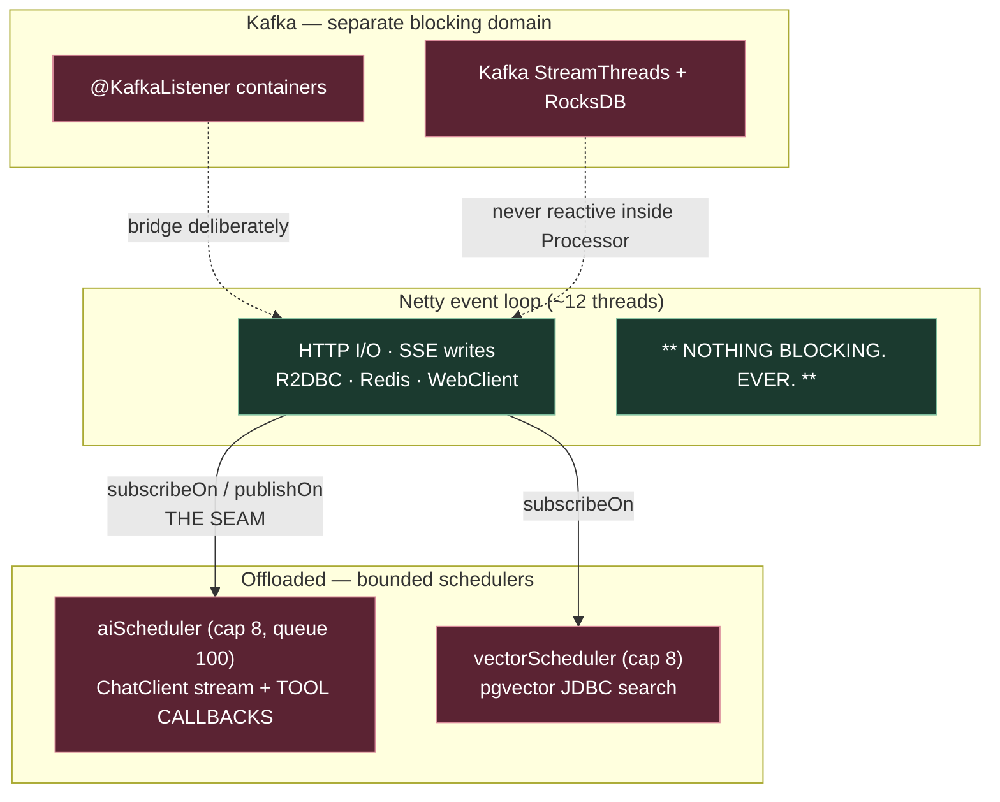

# 06 — Resilience & the Thread Model

## Thread model — the explicit boundary

The section to read twice.



Stated as rules, because they will otherwise be violated:

1. **`aiScheduler` must be explicitly bounded — not `Schedulers.boundedElastic()`.** The default is effectively unbounded (~60k threads); under load that becomes unbounded contention on a 9.6 GB model and an OOM. A bounded pool sheds load instead. **Backpressure is the feature.**
2. **Cap ≈ 8** — roughly the concurrent gemma4 requests a 12-CPU box sustains. Beyond that: queue, then reject into the Tier-3 fallback. *(Estimate from CPU count, not a measured figure — tune against real TTFT.)*
3. **Tool callbacks inherit `aiScheduler`** and must never run on a Netty thread.
4. **BlockHound in tests from day one of Phase 5.** Event-loop blocking otherwise surfaces as mysterious production latency, not as a CI failure.

> **If Spring AI later ships reactive tool callbacks, the offload becomes a one-line deletion** rather than a refactor. Design for that day.

## The OpenFeign decision

You asked for OpenFeign by name. **I recommend against it on the hot path**, and the strongest argument is not mine:

> **Spring Cloud has officially declared OpenFeign feature-complete** and recommends migrating to Spring HTTP Interface Clients. Choosing Feign now means adopting a component its own maintainers have stopped developing.

The technical argument reinforces it: Feign is blocking. In WebFlux, a blocking call on an event-loop thread stalls **every** concurrent request multiplexed on that thread — not just the caller. With ~12 event-loop threads and 120s Ollama calls in the mix, a handful of slow Feign calls can wedge the entire service.

| | OpenFeign | HTTP Interface Clients (recommended) |
|---|---|---|
| Maintenance | **Feature-complete (frozen)** | Actively developed |
| Blocking | Yes | No (`Mono`/`Flux` via `WebClientAdapter`) |
| Event-loop safety | Requires offload | Native |
| Resilience4j | Reactive decorators unavailable | Full reactive operators |
| Boot 4 fit | Legacy | First-class (part of `spring-web`) |

### Recommended approach

```java
@HttpExchange("/api/inventory")
public interface InventoryClient {
    @PostExchange("/holds")
    Mono<HoldResponse> createHold(@RequestBody HoldRequest req);
}
```

Register via `@ImportHttpServices` on a config class — **Boot 4 deliberately moved configuration off the interface** — backed by a load-balanced `WebClient` (`WebClientAdapter` + Spring Cloud LoadBalancer) and wrapped in Resilience4j reactive operators. Drop `spring-cloud-starter-openfeign` entirely.

**Ergonomically this is Feign; mechanically it is reactive.** The requirement's intent — declarative, annotation-driven inter-service clients — is fully met.

### Where OpenFeign remains legitimate

A **non-reactive batch/admin/reporting service** — plain Spring MVC on Java 25 virtual threads, no event loop to protect, blocking I/O is fine. Nightly reconciliation, ops back-office, report generation.

That is a genuine home for it, not a consolation prize. If you want Feign in the stack for familiarity, put it there (Phase 7). What to avoid is Feign anywhere on the reactive request path.

## Resilience4j per integration point

| Integration | Timeout | Circuit breaker | Bulkhead | Retry |
|---|---|---|---|---|
| **Ollama chat** | **120 s** | 50% / 20 calls, open 60 s | **8, isolated** | **None** |
| Ollama embeddings | 15 s | 50% / 20 | 8 | 2× backoff |
| pgvector (JDBC) | 5 s | 50% / 20 | separate blocking pool | 1 |
| inventory hold | 2 s | 40% / 50 | 32 | **None** |
| booking confirm | 5 s | 40% / 30 | 30 | None |
| payment | 10 s | 30% / 20 | 20 | 1, same idempotency key |
| catalog read | 1–3 s | 50% / 50 | 64 | 2 |
| Redis | 200 ms | fail-open to DB | — | 1 |

### Three deliberate choices, each counter to a common instinct

1. **The Ollama bulkhead is the single most important control here.** A 120s timeout with unbounded concurrency means one traffic spike parks every resource on LLM calls and takes the booking path down with it. Capping confines LLM latency to *the chat feature*; overflow fails fast into the Tier-3 fallback. This is requirement #6's real intent.

2. **No retry on Ollama.** Retrying a 120s call that is already failing turns one slow request into three and drives the box into swap.

3. **No blind retry on seat holds or payments.** Retrying a mutating call without knowing whether it committed is precisely how double-bookings and double-charges happen. **Idempotent replay with the original key is the correct pattern; blind retry is not.**

### Implementation note

Use semaphore **`Bulkhead`** — `ThreadPoolBulkhead` is incompatible with reactive types and misbehaves silently.

## Fallbacks

| Failing dependency | Fallback |
|---|---|
| catalog | stale Redis cache |
| availability | KStreams materialized view |
| Ollama | deterministic intent parsing → structured search UI ([02-ai-layer.md](02-ai-layer.md)) |
| Redis | fail-open straight to Postgres (correctness unaffected — see [03-consistency.md](03-consistency.md)) |