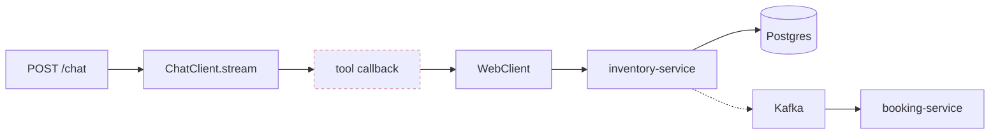

# 07 — Observability

Micrometer → Prometheus (`/actuator/prometheus`) → Grafana.
Micrometer Tracing → OpenTelemetry → Tempo (or Jaeger).

## Metrics that actually matter

Beyond the golden signals, these are the ones worth building dashboards on.

| Metric | Type | Why |
|---|---|---|
| `booking.funnel{stage}` | Counter | search → hold → pay → confirm drop-off |
| `seat.hold.contention{trainId}` | Counter | Lock failures = oversubscribed train. Capacity signal. |
| `seat.hold.expired.ratio` | Gauge | Squatting / abandoned carts; TTL tuning |
| `llm.request.duration{model,hasTools}` | Timer | Total p50/p95/p99 |
| **`llm.ttft`** | Timer | **Time to first token — the real perceived-latency metric for streaming** |
| `llm.tokens{direction}` | Counter | prompt vs completion; throughput proxy |
| `tool.call{tool,outcome}` | Counter | **The key AI-quality metric.** Tool success rate; hallucinated-arg detection |
| **`ai.scheduler.queued`** | Gauge | **Saturation of the bounded AI pool** |
| `llm.fallback.triggered{tier}` | Counter | How often the AI degrades |
| `ai.hallucinated_price` | Counter | Guardrail-4 violations ([02-ai-layer.md](02-ai-layer.md)) |
| `rag.retrieval.duration` / `rag.chunks.returned` | Timer / Counter | RAG health |
| `saga.compensation{type}` | Counter | Every one is a near-miss worth reviewing |
| `outbox.lag` | Gauge | Unpublished event age — **page on this** |

> **`ai.scheduler.queued` and `llm.ttft` belong on the first dashboard.** They are the leading indicators for the AI path's specific failure mode — pool saturation — which ordinary request-rate metrics cannot see. A saturated bounded scheduler looks perfectly healthy in RPS terms right up until every chat request is rejected.

## Tracing

Trace context must propagate across:
- `WebClient` calls (automatic)
- **Kafka** — producer/consumer header interceptors
- **The `aiScheduler` boundary and into tool calls** — otherwise every trace dies at the interesting moment

One trace must span `chat → LLM → tool → inventory → Postgres`. Without it, *"why did it book the wrong seat"* is unanswerable — and with an LLM in the loop, that question will be asked.

Sampling: 100% in dev; 10% + always-on-error in prod.

## Logs

Structured JSON with `traceId`, `userId`, `conversationId`, `bookingRef`.

> **Never log full prompts or completions in production** — they contain PII (names, journeys, payment references). Log hashes plus token counts; gate full capture behind an explicit debug flag with a short TTL.

## Dashboards

| Dashboard | Panels |
|---|---|
| Booking Funnel | stage conversion, contention, hold expiry ratio |
| AI Assistant Health | `llm.ttft`, `ai.scheduler.queued`, `tool.call` success rate, fallback tier |
| Saga / Outbox Health | compensation counts, `outbox.lag`, DLT depth |
| Service Golden Signals | rate, errors, duration, saturation per service |