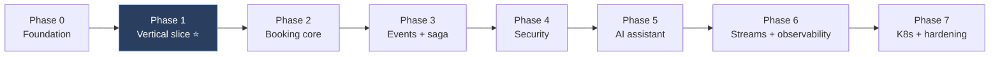

# 09 — Roadmap, Verification & Risks

## Phased delivery

**Phase 0 — Foundation (~1w).** `git init`. Convert root to parent POM (delete root `src/`), pin `spring-ai-bom:2.0.1`, create `common-core` + `common-web`, `docker-compose` with profiles.
*Exit: `./mvnw verify` green; one service up in Docker.*

**Phase 1 — Vertical slice, no AI, no auth (~2w). ⭐ The most important phase.**
`catalog-service` (Mongo) + `inventory-service` (Postgres, real seat holds) + a minimal React search page. Real R2DBC, real locking.
*Exit: search a train and hold a seat, end to end.*
**This validates the riskiest structural assumption — reactive Postgres + Mongo under WebFlux — before it is expensive to change.**

**Phase 2 — Booking core (~2w).** `booking-service`, `payment-service` (stub PSP), idempotency keys, optimistic concurrency, hold TTL sweeper.
*Exit: a seat can be held, paid and confirmed; a forced payment failure releases it.*

**Phase 3 — Events (~2w).** Kafka, outbox + relay, choreographed saga with compensations, `ticketing-service`, `notification-service`.

**Phase 4 — Security (~1w).** Keycloak realm, PKCE in React, resource-server config across services, Kong OSS routing/rate-limiting (patched 3.16.x).

**Phase 5 — AI assistant (~2w).** `ai-assistant-service`: `aiScheduler` / `vectorScheduler`, dual Postgres pools, RAG ingestion (<512-token chunks, `vector(1024)`), **read-only tools first**, then mutating tools with human-in-the-loop confirm. SSE streaming to React.
**BlockHound in tests from day one of this phase.**

**Phase 6 — Streams + observability (~1.5w).** `seat-availability-streams`, Prometheus/Grafana/Tempo, custom metrics, WebSocket live seat map, Resilience4j tuning under load.

**Phase 7 — K8s + hardening (~2w).** Helm charts (authoring only — no cluster). Fraud topology, Debezium CDC, seat-contention load tests, DLT replay tooling, optional `batch-admin-service` (the legitimate OpenFeign home).

> **Why AI lands at Phase 5, not Phase 1:** the LLM is a routing layer over deterministic services. Building it first would mean tools with nothing behind them. The booking system must work without the AI ([02-ai-layer.md](02-ai-layer.md)) — so build the thing that must work first.

## Verification per phase

| Phase | How to verify |
|---|---|
| 0 | `./mvnw -q verify`; `docker compose --profile core up -d`; `curl :8081/actuator/health` |
| 1 | Testcontainers integration test. **Concurrency test: N parallel holds on one seat → exactly 1 success.** |
| 2 | Forced payment failure → seat returns to `AVAILABLE`. Replayed `Idempotency-Key` → original 201, not a second booking. |
| 3 | Kill a consumer mid-saga → outbox relay redelivers, compensation fires, no orphaned hold. |
| 4 | PKCE token from Keycloak; call with/without scope → 200/403. Direct service call bypassing Kong → still 401. |
| 5 | `curl -N -X POST :8080/api/chat` → SSE tokens stream. **Ingestion test asserting every chunk ≤ 500 tokens.** **BlockHound: no blocking call on an event-loop thread.** **Negative test: user A's token requesting user B's booking through chat → denied.** |
| 6 | `/actuator/prometheus` exposes custom metrics; one Tempo trace spans chat → tool → inventory → Postgres. `docker stop ollama` → chat degrades to Tier 3/4 while `POST /bookings` still succeeds. |
| 7 | `helm template` clean; deploy to kind; probes green. |

### Confirm at the start of Phase 5

Both cheap; both change the design if they go the other way.

1. **Reactor Context survival** into Spring AI tool callbacks — else use `ToolContext` explicitly ([02-ai-layer.md](02-ai-layer.md)).
2. **`PgVectorStore` offload** actually keeps the event loop clean — verify with BlockHound.

## Risk register

| Risk | Severity | Mitigation |
|---|---|---|
| Reactor Context lost in tool callbacks → **auth bypass** | **High** | Capture identity before `subscribeOn`; `ToolContext` fallback; Phase 5 negative test |
| Seat-hold race under real concurrency | **High** | Conditional UPDATE correct without Redis; explicit load test in Phase 7 |
| Blocking leak onto the event loop | **High** | Bounded schedulers; **BlockHound in tests**; code-review rule |
| Scope — this is a large system | **High** | Phase 1 vertical slice non-negotiable; resist building all 8 services up front |
| LLM hallucinates bookings | **High** | Two-phase hold; human-in-the-loop confirm; idempotency; deterministic truth |
| Spring AI 2.x API churn (young GA line) | **High** | Wrap behind own `ChatOrchestrator` interfaces; blast radius = one package |
| 36 GB exhausted | **High** | Compose profiles; never run `full` + all JVMs |
| Kong OSS JWT key rotation breaks auth | **High** | Authoritative validation in Spring Security, not Kong |
| CVE-2026-14916 (Kong JWT bypass) | **High** | Patched 3.16.x; never rely on Kong alone |
| Dual Postgres pools exhaust connections | Medium | Sizing in [00-overview.md](00-overview.md); fallback = extract `rag-service` |
| gemma4 tool-calling reliability at Q4 | Medium | temp=0.2, few tools, strict schemas; track `tool.call`; larger tag if <90% |
| gemma4 too slow on CPU | Medium | Measure `llm.ttft` early; smaller model is a valid fallback |
| Choreographed saga becomes undebuggable | Medium | `saga_state` from day one; orchestration past ~5 participants |

## Known unknowns

Flagged rather than glossed:

- **gemma4 tool-calling quality is unmeasured.** The `tools` capability is confirmed present, but *how reliably* an 8B quantised model produces well-formed calls against a 6-tool schema is unknown. **This is the single biggest unknown in the design.** Prototype it early in Phase 5 before committing to the tool surface; if reliability is poor, the mitigations are fewer tools, constrained/structured output, or a larger `gemma4` tag.
- **The bulkhead cap of 8 is a reasoned estimate** from 12 CPUs, not a measured figure. Tune against real TTFT.
- **Spring AI 2.0.1 property names** should be checked against 2.0.1 docs at implementation time — the API shape was verified, the exact autoconfiguration keys were not.
- **HTTP Interface Clients + load balancing + Resilience4j** is newer ground than the Feign path; expect some integration friction.