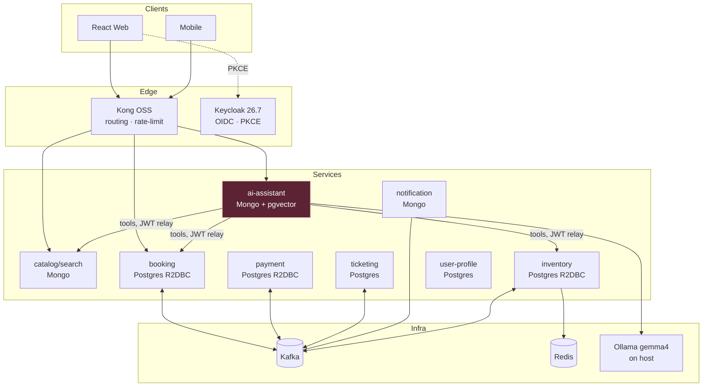

# AI Train Booking System — Architecture & Delivery Plan

Design documents for an AI-driven train booking system built as reactive Spring microservices, with a **local** Ollama model (`gemma4`) that books real trains by calling real services — never by inventing data.

**Status:** design only. No implementation yet. Start at [09-roadmap.md](09-roadmap.md) Phase 0.

## Index

| Doc | Contents |
|---|---|
| [00-overview.md](00-overview.md) | Context, verified version matrix, the two constraints that shape everything |
| [01-services.md](01-services.md) | Service decomposition, datastore per service, APIs and events |
| [02-ai-layer.md](02-ai-layer.md) | Chat flow, tools, guardrails, identity propagation, RAG, fallback |
| [03-consistency.md](03-consistency.md) | Seat holds, saga, outbox, idempotency — the genuinely hard part |
| [04-kafka.md](04-kafka.md) | Topic topology, partitioning, where Kafka Streams earns its place |
| [05-security.md](05-security.md) | Keycloak realm, PKCE, defence in depth, the Kong OSS limitation |
| [06-resilience.md](06-resilience.md) | Thread model, Resilience4j settings, the OpenFeign decision |
| [07-observability.md](07-observability.md) | Metrics that matter, tracing across the scheduler boundary |
| [08-deploy.md](08-deploy.md) | Compose profiles, reaching Ollama, K8s, monorepo layout |
| [09-roadmap.md](09-roadmap.md) | Phased delivery, verification per phase, risk register |

See also [`../CLAUDE.md`](../CLAUDE.md) for the hard constraints that must not be violated.

## The three findings that shaped this design

All verified directly against Maven Central and bytecode — not recalled.

1. **Spring AI 2.0.1, never 1.x.** The 1.1.x line targets Boot 3.5.7; only 2.x targets Boot 4.1.
2. **The AI path cannot be fully reactive.** `PgVectorStore` is JDBC-only and `ToolCallback.call()` returns a bare `String`. Streaming *is* reactive, so the blocking boundary is exactly one seam: the tool callback.
3. **`gemma4` supports tool calling** — confirmed via `ollama show`. The entire design hinges on this.

## Architecture at a glance

The highlighted `ai-assistant` is the one service that is **not** fully reactive — see [02-ai-layer.md](02-ai-layer.md) and [06-resilience.md](06-resilience.md).